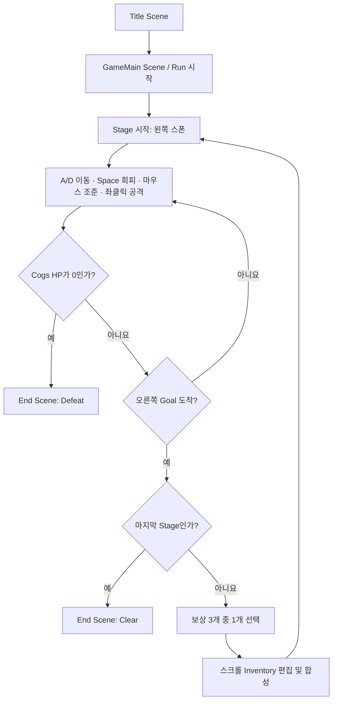

# Cogs & Gears — 프로젝트 스펙

> **Version:** 1.0 (초기 개발 스펙)  
> **기준일:** 2026-11-06  
> **프로젝트 이름:** `CogsAndGears`  
> **표기:** **확정** / **MVP 제안** / **미정** 구분  
> **목적:** 개발자가 직접 코딩하고 Unity Editor를 조작하기 위한 기능·구조 기준 문서


## 1. 프로젝트 개요

| 항목 | 내용 | 상태 |
|---|---|---|
| 게임명 | Cogs & Gears | 확정 |
| Unity 프로젝트명 | `CogsAndGears` | 확정 |
| 장르 | 2.5D 횡스크롤 런앤건 × 백팩 빌딩 × 스팀펑크 연금술 | 확정 |
| 개발 | 1인 직접 개발, AI는 설계/리서치/문서 정리 보조 | 확정 |
| 초기 플랫폼 | PC 프로토타입 | MVP 제안 |
| 플레이 형태 | 스테이지를 돌파하며 보상 아이템을 배치해 빌드를 강화 | 확정 |
| 월드 콘셉트 | 동화풍 스팀펑크, 연금술 공방, 거대한 이동식 기계성 | 콘셉트 확정 |

### 1.1 시각적 방향

- 따뜻한 수채화·핸드페인팅 느낌의 2D 배경과 스타일라이즈드 3D 캐릭터 혼합.
- 청록색 코트·황동 고글·가죽 장비·포션을 지닌 발명가 **Cogs**.
- 황동 기계 부품과 파란색 눈을 지닌 고양이 동료 **Gears**.
- 세계관 중심의 **움직이는 성**은 콘셉트 요소로 유지하되, 별도 내부 허브 Scene은 초기 MVP 범위 밖으로 둠.


## 2. 핵심 게임 루프 — 확정



- **Run:** Title에서 시작해 Clear/Defeat로 종료되는 1회 플레이.
- **Stage:** Run 안의 진행 구간. 왼쪽 Spawn → 오른쪽 Goal을 향해 이동하는 횡스크롤 맵.
- **Stage Clear:** Goal에 도달하면 완료. **모든 몬스터 처치는 필수 조건이 아님**.
- **정비 구간:** 일반 Stage Clear 직후 **보상 3개 중 1개를 선택**하고 Inventory 배치/재배치/합성 수행. 이후 Next Stage 시작.
- **최종 Stage:** 완료 직후 Run Clear로 이동하는 흐름을 MVP 기본값으로 사용. 최종 보상 제공 여부는 추후 결정.
- **Defeat:** Cogs HP가 0이 되면 End Scene에서 실패 결과 표시.
- **Scene:** `Title`, `GameMain`, `End` 세 개를 사용. Stage별 맵은 GameMain에서 Prefab을 교체하는 방식을 우선 검토.

## 3. 이동 / 입력 — 확정

| 입력 | 게임 행동 | 구현 후보 |
|---|---|---|
| A / D | 좌우 지상 이동 | Rigidbody2D 기반 PlayerMotor2D |
| Space | 회피 / 짧은 대시 | 회피 이동 + 짧은 무적 + 쿨타임 |
| 마우스 이동 | 360도 자유 조준 | PlayerAim2D |
| 마우스 좌클릭 | 장착된 공격 아이템 발동 | PlayerCombat |
| 점프 | **없음** | 구현하지 않음 |

### 3.1 회피 세부 정책

- 회피 방향: A/D 입력이 있으면 해당 방향, 없다면 마지막 캐릭터 Facing 방향 (**MVP 제안**).
- 회피 중 마우스 조준은 계속 업데이트. 회피 중 공격을 허용할지는 플레이테스트 검증 항목.
- 회피 거리, 소요 시간, 무적 프레임, 쿨타임은 **수치 미정**.
- 점프가 없으므로 필수 진행 경로는 끊어진 발판·높이 차이로 막지 않음.

### 3.2 조준과 2.5D 비주얼

- **게임플레이:** XY 평면에 `Rigidbody2D` / `Collider2D`, 마우스 월드 XY 방향으로 정확한 발사 벡터 계산.
- **비주얼:** 3D `VisualRoot`를 조준의 좌/우 부호에 따라 회전. 수직 근처에서는 이전 Facing을 유지해 떨림 방지.
- **Animator:** Base Layer(Idle/Run/Dodge/Hit/Death) + UpperBody Mask Layer(Aim/Fire/Throw/Cast).
- **IK:** Animation Rigging으로 팔·손 조준을 보정. 관절의 자연스러운 범위까지만 IK 목표를 배치.
- **중요:** 실제 투사체 방향은 원본 360° 조준 벡터를 사용하며, IK 제한 각도로 탄도를 변경하지 않음.
- **Root Motion:** 사용하지 않는 방향. 게임플레이 이동은 PlayerMotor2D가 결정.
- **발사체:** Physics2D 충돌 기준; 시각적 총구와 게임플레이 발사 기준점을 필요에 따라 분리.

## 4. 핵심 시스템

### 4.1 Cogs 플레이어

**책임:** 입력, 지상 이동, 회피, 360° 조준, 장비 발동, HP/실드, 피격/사망, 애니메이션.

**예상 컴포넌트:** `PlayerInputHandler`, `PlayerMotor2D`, `PlayerAim2D`, `PlayerFacingController`, `PlayerCombat`, `Health`, `Shield`, `PlayerAnimationController`.

**오브젝트 설계 (초안):**

```text
Cogs (Root, XY gameplay)
├── Rigidbody2D / CapsuleCollider2D
├── Input / Motor / Aim / Combat / Health
├── AimOrigin                   # 실제 공격 기준
└── VisualRoot                 # 3D 방향 전환 전용
    ├── CogsModel (Animator + Armature)
    ├── Animation Rigging / IK Targets
    └── Equipment Visual Sockets
```

> 컴포넌트와 계층명은 설계 초안. 모델의 실제 본/전방 축에 맞게 조정.

### 4.2 Gears 동료

- 기계 고양이 3D 모델, 애니메이션, Cogs 추적 및 적절한 거리 유지.
- Stage 전환 시 추적 대상·위치 초기화.
- 전투 참여·아이템 탐색·스킬 보조 등은 **미정 / MVP 제외**.

### 4.3 Monster

- 1차: 근접 추적형 1종, 이후 원거리 공격형 1종.
- HP/피격/사망, 탐지/이동/공격, Stage 스폰 설정.
- 공격 로직과 3D 애니메이션 분리, Physics2D로 게임플레이 판정.

### 4.4 공격 시스템

- 스크롤에 배치된 **공격형 아이템** 각각 독립 쿨타임 보유.
- 좌클릭 입력 시 발동 가능한 공격 아이템을 모두 실행. 홀드 시 쿨타임마다 반복하는 방식은 **MVP 제안(세부 UX 미검증)**.
- 공격 종류: 총기, 마법, 포션, 기계장치.
- 여러 공격이 동시에 발동해도 계산/투사체는 모두 실행하고, 3D 상체 연출만 우선순위에 따라 조정.
- 투사체/효과 오브젝트 풀링은 반복 발사 성능 테스트에서 도입.

### 4.5 Stage / Run

- `RunDefinition` SO: Run을 구성하는 `StageDefinition` 참조 목록.
- `StageDefinition` SO: Stage Prefab, 순서/난이도/스폰 조건 등 정적 설정.
- `StagePrefab`: Ground, Bounds, PlayerSpawn, MonsterSpawns, GoalTrigger, Background.
- 런타임 상태: 현재 Stage 인덱스, HP/실드, 스크롤 인벤토리 상태, Clear/Defeat 결과.
- Stage 완료 여부와 Scene 이동/Prefab 교체는 구분해 처리.

### 4.6 마법 스크롤 Inventory — 확정 방향

- `Backpack Hero`형 2D 격자, 아이템마다 여러 칸을 점유하는 모양.
- 90도 회전, 배치 충돌 검사, 드래그앤드롭, 배치 미리보기.
- 인접 / 방향 / 범위 기반 시너지.
- 무기(공격), 유물(패시브), 일반 아이템을 구분.
- 동일 아이템 + 동일 레벨 조건으로 합성. 세부 최대 레벨 규칙은 **미정**.
- 격자 확장. 초기 크기·최대 크기·확장 타이밍은 **미정**.
- 별도 보관함은 두지 않고, 현재 스크롤에 배치/교체/포기하는 구조.
- **전투 중 Inventory 편집 불가. Stage Clear 정비 단계에서만 편집 가능.**

### 4.7 Stage 보상

- 일반 Stage 완료 시 3개 보상 후보 중 1개 선택.
- 희귀도: Common / Rare / Legendary.
- Stage Clear → Reward Select → Inventory Edit → Next Stage.
- 보상 확률, 보상 포기 시 처리, 인벤토리 공간 부족 정책은 **미정**.

### 4.8 HP / 실드

- Cogs HP 및 회복 가능한 실드 시스템을 계획에 포함.
- 피해 우선순위, 실드 재생 대기시간 및 재생량은 추후 설계.
- HP가 0이 되면 Defeat 진입.

## 5. 씬 구성 및 게임 상태

```text
Scenes/
├── Title.unity
├── GameMain.unity
└── End.unity

GameMain 내부 진행 상태 (예시; 별도 Scene 아님)
StageStart → Playing → StageClear → RewardSelection
                                      → InventoryEditing → NextStage
                   └─ 최종 스테이지 완료 → RunClear
어느 전투 구간에서든 HP 0 → Defeat
```

- **MVP 제안:** 별도의 범용 FSM 프레임워크를 도입하기보다 Run 흐름을 관리하는 소수의 명확한 상태와 Controller를 사용.
- UI 개방 시 전투 입력 및 시간 흐름 정지 정책은 구현 전 확정.

## 6. 기술 사양 / 제작 파이프라인

| 분야 | 계획 |
|---|---|
| Engine | Unity 6 LTS (`6000.x`, 정확한 패치 버전은 프로젝트 생성 시 기록) |
| Pipeline | URP Universal Renderer |
| 2D physics | Rigidbody2D / Collider2D / Physics2D |
| Camera | Orthographic, 횡스크롤 추적 및 Stage 경계 제한 |
| Input | Unity Input System |
| 3D Visual | SkinnedMeshRenderer + Animator, Humanoid(Cogs) / Generic(Gears 등) 검토 |
| IK | Unity Animation Rigging 패키지 |
| Content | ScriptableObject + Prefab 직접 참조 |
| Assets | Meshy.ai → Blender → FBX → Unity Import → Prefab |
| Build | Windows PC MVP 우선; 추가 플랫폼 미정 |

**파이프라인 검증 순서:** Meshy 모델 생성 → 모델 기본 포즈/본 구조 확인 → Blender 필요 수정 → Unity 임포트/Avatar 설정 → 애니메이션 확인 → VisualRoot에 연결 → Physics2D Root와 분리 확인.

### 6.1 프로젝트 폴더 구조 (초안)

```text
Assets/
└── CogsAndGears/
    ├── Art/
    │   ├── Characters/
    │   ├── Backgrounds/
    │   └── VFX/
    ├── Audio/
    ├── Animations/
    ├── Data/                    # ScriptableObject assets
    ├── Prefabs/
    │   ├── Characters/
    │   ├── Monsters/
    │   ├── Stages/
    │   └── UI/
    ├── Scenes/
    ├── Scripts/
    │   ├── Core/
    │   ├── Player/
    │   ├── Combat/
    │   ├── Monsters/
    │   ├── Stages/
    │   ├── Inventory/
    │   └── UI/
    └── Settings/
```

폴더는 개발과 함께 필요한 만큼 생성하며 사용하지 않는 추상화 계층을 미리 만들지 않는다.

## 7. 개발 이슈 상위 분류 (v1.3)

| ID | 상위 이슈 | 우선순위 |
|---|---|---|
| CG-01 | 프로젝트 초기 환경 구축 | P0 |
| CG-02 | 3D 리소스 제작 파이프라인 | P1 병렬 |
| CG-03 | 게임 진행 및 Scene 시스템 | P0 |
| CG-04 | Cogs 플레이어 및 조작 | P0 |
| CG-05 | 전투 및 공격 시스템 | P0 |
| CG-06 | Monster 시스템 | P0 |
| CG-07 | Stage 및 횡스크롤 맵 | P0 |
| CG-08 | 스크롤 Inventory 시스템 | P1 |
| CG-09 | Stage 보상 시스템 | P1 |
| CG-10 | Gears 동료 오브젝트 | P2 |
| CG-11 | UI·아트·사운드 | P2 |
| CG-12 | 테스트 및 배포 | P1 |

### 7.1 권장 구현 마일스톤

1. **Prototype:** 임시 모델로 A/D 이동, Space 회피, 360도 조준, 좌클릭 사격, 근접 Monster, Goal 도달 구현.
2. **Vertical Slice:** Title → Stage 1 → 보상/Inventory → Stage 2 → End Clear/Defeat를 1회 완주.
3. **Backpack Core:** 회전/배치/합성/시너지/스크롤 확장 및 독립 무기 쿨타임을 연계.
4. **Visual Polish:** Cogs/Gears/Monster 모델, IK, VFX, 배경 및 HUD 적용.

## 8. MVP 완료 조건 (초안)

- [X] Title에서 New Game으로 GameMain 시작.
- [X] Cogs가 지상에서 A/D 이동하며 Space로 회피하고, 점프하지 않음.
- [X] 마우스 360도 조준이 실제 투사체 방향에 반영됨.
- [X] 최소 공격 아이템 2개가 독립 쿨타임으로 동작함.
- [X] 최소 Monster 2종이 피격/사망 및 공격을 수행함.
- [X] 오른쪽 Goal 도달로 Stage가 클리어됨.
- [X] Stage Clear 후 보상 선택 및 스크롤 편집으로 다음 Stage 진입.
- [X] 최종 Stage 완료 시 Clear, Cogs HP 0 시 Defeat.
- [X] 인벤토리 배치/회전/겹침 판정/기본 시너지 동작.
- [X] Windows PC 개발 빌드에서 한 Run을 완주할 수 있음.

## 9. 미정 및 후속 기획

| 항목 | 현 상태 |
|---|---|
| 정확한 Unity 6 패치 버전 | 프로젝트 생성 시 고정 |
| 회피 속도·거리·무적 프레임 | 플레이테스트에서 결정 |
| 회피 중 공격 가능 여부 | 검증 필요 |
| 좌클릭 홀드/클릭 UX | 홀드 반복 발사 우선 시험, 미확정 |
| 인벤토리 초기/최대 크기와 확장 | 미정 |
| 합성 최대 레벨/전설 아이템 정책 | 미정 |
| 보상 희귀도 확률·공간 부족 처리 | 미정 |
| Run 내 Stage 수 및 최종 보상 | MVP 2개 Stage 제안, 이후 결정 |
| Gears 전투 참여 | 초기 비전투 동료 |
| 움직이는 성 내부 허브 | 세계관 및 후속 확장 기능 |
| 저장/Continue, 상점, 재화 | MVP 제외/추후 결정 |

## 10. 직접 개발 워크플로우

1. 설계 목적·입출력·책임 확인.
2. Unity Editor에서 Scene, GameObject, Component를 직접 설정.
3. 필요한 C# 클래스와 메서드를 직접 구현.
4. Play Mode 테스트 후 의도와 실제 결과 비교.
5. 문제 발생 시 코드·Inspector·Console 로그를 기반으로 리뷰.
6. 정상 동작 검증 후 문서 및 체크리스트 갱신.

**원칙:** Claude Code 등 AI 코딩 에이전트 미사용. AI는 기획/설계/공식 문서 리서치/기술 리뷰/문서화에만 활용. 단순한 구조, SRP, Unity 기본 기능 활용 우선.

---

> 이 문서에서 확정으로 명시되지 않은 수치와 UX는 구현 전 또는 플레이테스트 과정에서 결정한다. 콘셉트 아트는 최종 게임 화면을 보증하지 않는다.
