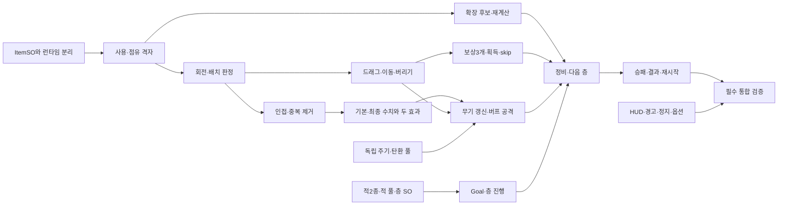

# Cogs & Gears — 미션 기반 개발 로드맵 구성안

기준일 2026-11-10, 승인 대기 초안. 공식 기간은 11/06~24, 기능 목표는 **11/20**, 발표·문서 준비는 **11/21~24**다. [실제 조사](planning/implementation-audit.md), [요구사항 추적표65행](planning/mission-requirements.md), [상위11·하위45 전체 Issue 초안](planning/github-issues-plan.md)을 함께 검토한다.

**필수 요구사항은 전부 구성안에 반영했다. 현재 구현 상태에서 11/20 전체 완성을 확약할 근거는 부족하다.** Scene·리소스·물리 설정 외에 전투·가방·UI·진행을 거의 새로 구현해야 한다. 아래는 검증 게이트가 있는 도전 일정이며 가용시간 답변과 실제 속도로 재산정해야 한다. 필수 기능을 조용히 삭제해 날짜를 맞추지 않는다.

## 우선순위와 최소 범위

| 구분 | 유지 | 뒤로 미룰 범위 |
|---|---|---|
| P0 미션 필수 | 비정형 격자·다중 칸·배치/회전/버리기·인접2효과·확장·SO·다중 독립 발사·실드·적2종·풀·필수 UI·Run 흐름 | 필수 삭제 없음 |
| P1 고유 MVP | 2.5D·점프 없음·Facing/Idle/Walk·최소 Parallax·기본 외 추가 타입1종 후보·버프 연동 | 복합 IK·네 공격 계열 전부·많은 모델/지형 제작 |
| P2 후순위 | 별도 T40~T45 | Gears·합성/강화·추가 AI/변이·방향/범위 효과·고급 UI/VFX·추가 콘텐츠 |

최소 콘텐츠 **제안**은 맵1세트 재사용, 데이터가 다른 3개 층, 기본+추가 타입 무기2종, 효과 제공 아이템2종, 1칸/가로2/세로3/ㄱ자 시험 모양, 확장1회다. 1층 기본 적→2층 혼합 적 후 확장→3층 수량/난이도 상승 후 Clear면 필수 경험을 검증할 수 있다. 층수·가방 크기·확장 시점/칸수·추가 타입·수치는 사용자 답변 전 확정하지 않는다. PDF의 6개 층은 예시다.

기본 전투는 임시 무기로 먼저 확인하되 무기별 인스턴스와 주기를 분리한다. SO 계약·셀 알고리즘과 얇은 Run 뼈대를 앞당겨 후반 재작업을 줄인다. 화려한 연출 대신 가방 정비 전후의 실제 공격 차이를 우선한다.

## 가용시간과 실현 가능성

11/10~20은 11일 중 **평일9일**이다. 발표 기간 중 공식 평일은 11/23~24의 2일이다. 주말11/14~15·11/21~22 작업을 자동 가정하지 않는다.

| 작업 묶음 | 직접 구현·연결·수동 확인 추정 |
|---|---:|
| 조작·카메라·기본 시각 | 8~12시간 |
| 다중 공격·탄환 풀·실드 | 9~13시간 |
| 적2종·적 풀·층 SO | 8~12시간 |
| ItemSO·최소 콘텐츠 | 4~6시간 |
| 격자·회전/배치·드래그·버리기 | 14~20시간 |
| 인접·수치·공격/표시·최소 추가 타입 | 12~18시간 |
| 보상·확장·정비 연결 | 9~13시간 |
| Run/Stage·승패·씬 연결 | 7~10시간 |
| 필수 HUD·정지·타이틀/결과/옵션 | 12~18시간 |
| 최종 리소스·알고리즘/통합·PC 검증 | 12~18시간 |
| **기능·검증 소계** | **105~140시간** |
| 학습·에셋 문제·통합 결함 여유 | **추가15~25시간** |
| **기능 완료 예상** | **120~165시간** |

개발자 숙련도·실측 속도가 없는 계획 가정이다. 발표자료6~10시간은 별도로11/21~24에 확보한다. 에셋 전면 교체가 필요하면 더 늘 수 있다.

- 평일8시간이면72시간: 예상 대비 **48~93시간 부족**. 주말16시간을 추가해도88시간으로 **32~77시간 부족**하다.
- 평일6시간이면54시간: **66~111시간 부족**하다. 실제 가용시간 답변 후 갱신한다.
- 따라서 현재 근거만으로 필수 MVP 전체를11/20 이전 검증 가능하다고 판단하지 않는다. 자산·UI 재사용과 최소 콘텐츠로 작업을 줄여도 게이트에서 실제 속도를 확인해야 한다.
- 발표 기간에 남은 기능을 자동 배정하지 않는다. 미달 시 남은 필수·실제 잔여시간·제출 영향을 보고하고 지원/기한/범위를 재협의한다. 필수 누락을 완료로 처리하지 않는다.

## 순서와 목표 게이트

1인이 한 번에 구현한다. 구간 중첩은 앞선 뼈대와 나중 연결의 목표 창이며 병렬 인력을 가정하지 않는다. 분량이 많은 사실을 숨기지 않으며 실제 날짜 확정은 가용시간과 첫 구현 결과에 달려 있다.

| 단계 | 목표 | 선행 순서·주요 ID | 통과 기준 |
|---|---|---|---|
| 0. 범위·에셋·데이터 계약 | 11/10 | T39→T11 | 시간·자산 허용·미확정 값을 명시 |
| 1. 조작·환경 | 11/10~11 | T01→T02/T03, T04 | 이동/대시·조준·카메라 양끝. T04 초과 시 고유 시각만11/19 후보로 보고 |
| 2. 기본 전투 | 11/11~13 | T05→T06, T07→T08/T09→T10 | 독립 발사·피해/실드·적2종·탄환/적 풀 |
| 3a. 가방 알고리즘 선착수 | 11/11~13 | T11→T13→T14, T12 | 회전4회·범위/잠김/겹침·비정형을 UI 전 고정 입력으로 확인 |
| 3b. 조작·인접·효과 | 11/13~17 | T15→T16, T17→T18→T20 | 실패 복구·중복 없는 인접·효과2종·SO 불변 |
| 3c. 실전 연결·보상·확장 | 11/17~18 | T19/T21, T22→T23, T24→T25 | 획득/skip→정비→확장→다음 교전의 공격 차이 |
| 4. Run·필수 UI | 뼈대11/11~12, 통합11/18~19 | T26→T27→T28, T29~T34 | Clear/Defeat·결과 마지막 가방·ESC 읽기전용 보기·볼륨 포함 |
| 5. 필수 통합 | 11/20 | T35/T36→T37 | PC 완주/실패/재시작·풀 회귀·필수 미검증0 |
| 6. 발표·문서 | 11/21~24 | T38 | 설계 이유·알고리즘 입출력·시연/영상·출처·미완료 명시 |

11/13 알고리즘/전투 게이트와11/18 가방-전투-정비 게이트 미달 시 즉시 일정 재평가한다. 11/20 게이트가 미달이면 발표 준비를 침범하기 전에 미완료를 보고한다. 합성·Gears·추가 콘텐츠는 착수하지 않는다.

72시간만 확보된 경우 배분 상한 예시는 조작8h·전투/적14h·SO/가방 알고리즘24h·보상/Run10h·필수UI10h·통합6h다. 합계72h지만 소계105~140h보다 적고 에셋/학습 여유도 없다. 이는 완성 보장이 아니라 용량 부족을 드러내는 기준이다.

## 핵심 의존성

회전·배치·인접·확장 및 시간/좌표 알고리즘의 입력·조건·예상 결과·수동 검증은 [각 Issue 본문](planning/github-issues-plan.md)에 있다. Codex는 정답 코드나 게임 테스트를 작성·실행하지 않는다. 기존 기반 Scene·물리·리소스는 재구현하지 않고 검증 근거만 보완한다.

## 위험과 축소 가능한 부분

| 위험 | 대응·유지할 필수 |
|---|---|
| UI 좌표·회전·드래그 실패 복구 | 계산부터 검증, 겹침 거부/복구 UX 제안. 비정형·회전·드래그·버리기는 유지 |
| 효과 계산과 공격 결합 | 정의/런타임/최종 계산/공격 분리. 두 효과·독립 주기·실제 성능 연결 유지 |
| UI가11/19에 집중 | 최소 HUD·Run 뼈대 선착수, 꾸미기 축소. 밖 적·결과 가방·정지 메뉴 누락 금지 |
| 적/탄환 풀 상태 초기화 | 일찍 재대여 검증. 적2종·SO·풀 요구 유지 |
| 애니메이션·Meshy 허용 | 담당자 확인·허용 에셋 재사용. 고급 IK·새 모델 제작 제외 |
| 콘텐츠 과다 | 맵1세트·3층·최소 무기 후보, 승인 전 고정 안 함 |
| 합성·Gears·허브 확장 | T40~T45 후속, 허브·세이브·상점은 이번 등록 제외 |
| 시간 부족 | 남은 필수와 부족 시간을 보고. 주말·발표 기간을 자동 소모하지 않음 |

## GitHub 구성·승인 대기

상위11개는 플레이어, 전투/실드, 적/층 전투, ItemSO, 그리드, 시너지/버프, 확장/보상, Run/Stage, UI, 통합/발표, Gears/후속이다. 하위45개 전체의 목적·출처·범위·설계·완료 조건·검증·선행·일정·MVP 구분을 [전체 초안](planning/github-issues-plan.md)에 작성했다.

최대 Issue56개·하위 연결45개·신규 라벨14개·마일스톤2개(11/20 기능,11/24 제출)가 생성 후보다. 기존 enhancement/documentation 등을 우선 재사용한다. 후속 E11+T40~45를 보류하면 초기49개·연결39개, area:gears도 보류 가능하다.

가용시간/주말, 에셋 허용, 층/확장 수치, 중첩, 추가 타입을 확인하고 생성 범위를 승인받기 전 GitHub를 변경하지 않는다. 실제 Git 작업은 사용자가 수행하며 Codex는 제안만 한다. 이번 산출물은 로컬 문서4개뿐이다.
